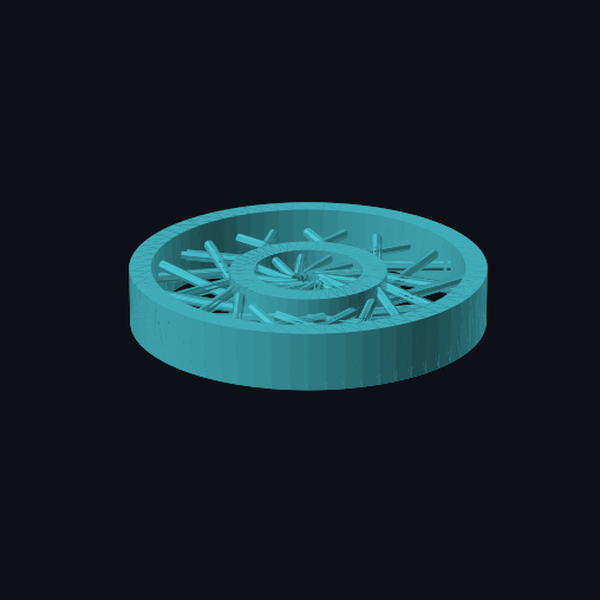

# GAD — Graph-Assisted Design of Multi-Material Spring Tires

Code and results for the paper

> **Graph-Assisted Design (GAD): A Multi-Objective GNN–Evolutionary Framework for Automated Structural Optimization**
> Gabriel A. Laurente Caldas, Sumy I. Huaman Woto — Universidad Nacional Mayor de San Marcos (UNMSM)
> 17th World Congress on Computational Mechanics (WCCM) / 10th ECCOMAS Congress, Munich, 19–24 July 2026
> PDF in [`paper/`](paper/)

GAD encodes each candidate airless wheel (NASA-style *Spring Tire* for planetary rovers) as an attributed
graph, trains a Graph Attention Network (GAT) ensemble as a surrogate, and optimizes ten objectives
simultaneously with NSGA-III. A *Surrogate Refresh* step periodically re-evaluates Pareto candidates with
high-fidelity 3D FEM (scikit-fem, TetP2) and feeds clamped exponential-moving-average correction factors
back into the optimizer.

<p align="center"></p>

## Pipeline

| Phase | Script | What it does |
|---|---|---|
| 1. Dataset | `scripts/fase1_spring_tire_dataset.py` | Latin Hypercube sampling of the 18-gene genome + analytical 2D FEA (Timoshenko beams) |
| 2. Surrogate | `scripts/fase2_spring_tire_gnn.py` | Ensemble of 5 GAT models (3 GAT layers, 256-d, 17 regression heads) |
| 3. Optimization | `scripts/fase3_spring_tire_nsga.py` | NSGA-III (pymoo), 10 objectives, Surrogate Refresh every 15 generations (top-5) |
| 4. 3D FEM | `fem3d_springtire_id79.py`, `scripts/validate_pareto_fem3d_fulltire.py` | scikit-fem TetP2, mesh study, fatigue / thermal / UV post-processing |
| 5. Export | `scripts/fase6_spring_tire_export.py`, `scripts/export_top20_pareto.py` | STL geometry for FFF printing |
| Analysis | `analyze_stl_id79.py`, `scripts/analyze_stl_visual.py` | Views, cross-section and connectivity figures of candidate ID 79 |

`scripts/run_spring_tire_pipeline.py` chains phases 1–3. Shared modules live in `utils/`
(genome decoding, 2D FEA, 3D FEM, geometry, STL validation).

## Installation

```bash
python -m venv .venv && source .venv/bin/activate
pip install -r requirements.txt
```

PyTorch and PyTorch Geometric should be installed for your hardware (CUDA, ROCm or CPU) following their
official instructions. The 3D FEM runs with scikit-fem by default; FEniCS/DOLFINx is optional
(`--solver fenics`).

## Reproducing the results

Run every command from the repository root.

```bash
# 1. Dataset (the dataset used in the paper is ~1.5 GB and is not included)
python scripts/fase1_spring_tire_dataset.py --n-samples <N> --output-dir results/data

# 2. GAT ensemble (pre-trained weights are already in results/models/)
python scripts/fase2_spring_tire_gnn.py --dataset results/data/spring_tire_dataset.json --n-models 5

# 3. NSGA-III — extended study reported in the paper (population 1000, 500 generations)
python scripts/fase3_spring_tire_nsga.py --pop-size 1000 --n-gen 500 --n-obj 10 --no-fem3d

#    NSGA-III with Surrogate Refresh active (3D FEM every 15 generations on the top-5 candidates)
python scripts/fase3_spring_tire_nsga.py --pop-size 100 --n-gen 200 --n-obj 10 --refresh-every 15 --top-k 5

# 4. High-fidelity 3D FEM of candidate ID 79 (h = 1.5 mm, mesh study included)
python fem3d_springtire_id79.py --mesh-size 1.5 --output fem3d_pub_results

# 5. STL export of the Pareto front
python scripts/fase6_spring_tire_export.py --pareto results/pareto/pareto_spring_tire_20260314_223722.json
```

## Included results

| Path | Content |
|---|---|
| `results/pareto/pareto_spring_tire_20260314_223722.json` | Extended run: 103 Pareto solutions, population 1000, 500 generations, 10 objectives, 497 220 2D-FEA evaluations (22 387 s) |
| `results/pareto/pareto_spring_tire_20260314_161639.json` | Run with Surrogate Refresh active (100 × 200, 13 refreshes, clamped correction factors) |
| `results/models/` | The 5 trained GAT models and their scalers |
| `results/fem3d_id79/` | 3D FEM report for ID 79 (`reporte_id79_pub.json`), mesh-convergence data and figures |
| `results/analysis_id79/` | STL of candidate ID 79 |
| `results/Final_Pareto/` | STL files of the top-ranked Pareto candidates |

**Candidate ID 79** (peak stiffness): k<sub>v</sub> = 796.6 kN/m, von Mises safety factor 20.06 on a
1 328 466-DOF TetP2 solution, Goodman ratio 0.070, shape-recovery ratio 96.9 %, mass 3.346 kg.

## Notes and limitations

- As stated in the paper, the three-mesh study lies outside the asymptotic range (Richardson extrapolation
  gives a non-physical value), so the reported safety factors are indicative; vertical stiffness is
  dominated by the empirical cap K<sub>MAX</sub> of the Timoshenko–Voigt model (±30–40 % uncertainty).
- All results come from open-source simulation; no prototype was built or tested.

## Citation

See [`CITATION.cff`](CITATION.cff).

## License

Code released under the [MIT License](LICENSE). The paper in `paper/` is © its authors.
